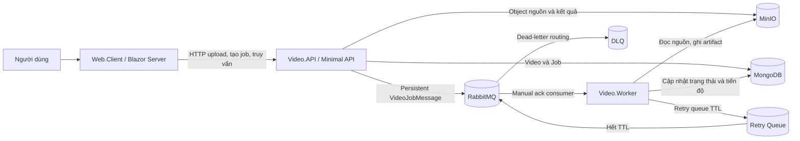

# BÁO CÁO BÀI TẬP LỚN

# Đề tài 14: Hệ thống xử lý video bất đồng bộ

## 1. Bài toán và mục tiêu

Upload video có thể kéo theo các tác vụ tốn CPU, bộ nhớ và thời gian như phân tích metadata, chuyển mã hoặc tạo thumbnail. Nếu xử lý ngay trong request HTTP, người dùng phải chờ lâu; request có thể timeout và API khó mở rộng độc lập với tải xử lý.

Đề tài xây dựng hệ thống phân tán tách tiếp nhận video khỏi xử lý nền. API lưu file và metadata, phát sinh job vào message broker, Worker xử lý độc lập và ghi trạng thái để client truy vấn. Hệ thống dùng MongoDB cho trạng thái, MinIO cho file và RabbitMQ cho message bất đồng bộ.

Mục tiêu chức năng gồm upload video, tạo nhiều job cho một video, cập nhật tiến độ, tra cứu trạng thái, tải kết quả và tiếp tục xử lý khi Worker được khởi động lại. Mục tiêu phi chức năng gồm cấu hình qua môi trường, kiểm tra sức khỏe phụ thuộc, retry có giới hạn, idempotent consumer và dead-letter queue.

## 2. Phân tích yêu cầu và mô hình dữ liệu

### 2.1 Yêu cầu chức năng

- Nhận multipart upload video, lưu object vào MinIO và metadata vào MongoDB.
- Tạo Job riêng cho từng tác vụ và publish message đến RabbitMQ.
- Hỗ trợ `Thumbnail`, `Metadata` và `Transcode`.
- Liệt kê video có lọc trạng thái; xem video cùng danh sách jobs; tra cứu trạng thái, tiến độ và kết quả job.
- Cho phép tải artifact đầu ra từ MinIO.
- Truyền Correlation ID từ HTTP qua RabbitMQ đến log của Worker.

### 2.2 Mô hình dữ liệu

MongoDB dùng hai collection độc lập, `Videos` và `Jobs`; quan hệ là một video có thể có nhiều job. Tài liệu Job có các trường `Id`, `VideoId`, `JobType`, `Status`, `Progress`, `OutputPath`, `Result`, `ErrorMessage`, `CreatedAt`, `UpdatedAt` và `CorrelationId`. `Status` nhận `Pending`, `Processing`, `Completed` hoặc `Failed`; `Progress` nằm trong khoảng 0 đến 100.

Collection `Videos` lưu định danh, tên file, trạng thái tổng hợp và thời điểm upload. Trạng thái video được tính từ các job liên quan: ưu tiên `Processing`, sau đó `Pending`, `Failed`, rồi `Completed` khi tất cả job đã hoàn tất.

### 2.3 Phạm vi xử lý

Worker tải file gốc từ MinIO. `Thumbnail` dùng FFmpeg tạo ảnh JPEG; `Metadata` tạo JSON với tên file, phần mở rộng và kích thước; `Transcode` tạo artifact JSON mô phỏng, chưa thực hiện chuyển mã codec thật. Các artifact được ghi lại lên MinIO và đường dẫn được lưu trong Job.

## 3. Kiến trúc hệ thống



Web.Client là ứng dụng Blazor Server; các request gọi Video.API được gửi từ server, không phải JavaScript chạy trong browser. Do đó không cần bật CORS wildcard. Video.API và Video.Worker cùng truy cập MongoDB, MinIO và RabbitMQ qua tên service trong Docker network. Docker Compose dùng healthcheck và `depends_on` với `condition: service_healthy` để sắp thứ tự khởi động.

## 4. Giao tiếp phân tán và cơ chế chịu lỗi

### 4.1 HTTP và API

Video.API dùng ASP.NET Core Minimal API, cung cấp năm endpoint nghiệp vụ ở cả route gốc và alias `/api`:

| Phương thức | Route | Chức năng |
| --- | --- | --- |
| `POST` | `/videos` | Nhận multipart field `file`, lưu file MinIO và metadata MongoDB. |
| `POST` | `/videos/{id}/jobs` | Tạo Job theo `JobType`, lưu MongoDB và publish message; trả `202 Accepted`. |
| `GET` | `/videos` | Liệt kê video; hỗ trợ `?status=Completed`. |
| `GET` | `/videos/{id}` | Trả metadata video cùng danh sách jobs. |
| `GET` | `/jobs/{id}` | Trả trạng thái, tiến độ, kết quả và lỗi của job. |

Endpoint bổ sung `GET /jobs/{id}/result` tải artifact của Job từ MinIO. API `/health` ping MongoDB, xác minh bucket MinIO và kiểm tra kết nối RabbitMQ; trả `{"status":"Healthy"}` nếu tất cả sẵn sàng, nếu không trả HTTP 503.

Khi upload, API tạo GUID làm video ID và object key. Khi tạo job, API ghi bản ghi `Pending` trước khi publish. Nếu publish phát sinh lỗi, API ghi job `Failed` với `ErrorMessage`.

### 4.2 RabbitMQ và định tuyến

Queue chính `video-uploaded` là durable; publisher gửi persistent message. Worker consume với `autoAck=false` và `BasicQos(prefetchCount: 1)`. Retry queue durable có TTL và dead-letter routing trở lại queue chính khi hết thời gian chờ. Queue chính cấu hình dead-letter exchange/routing key đến queue `video-uploaded.dead`.

Khi xử lý thành công, Worker ack sau khi dữ liệu kết quả đã được ghi. Khi lỗi tạm thời, Worker cập nhật trạng thái Job về `Pending`, publish bản sao persistent vào retry queue rồi ack delivery ban đầu. Nếu không thể publish retry, Worker nack với `requeue=true` để message không bị loại bỏ. Khi hết số lần retry, Worker ghi Job `Failed` và nack với `requeue=false`; RabbitMQ dùng dead-letter routing để đưa message vào DLQ.

Worker thử kết nối RabbitMQ khi khởi động với số lần thử giới hạn và backoff tăng dần. Connection factory bật automatic recovery cho mất kết nối sau khi khởi động.

### 4.3 Idempotency và phục hồi

Trước khi xử lý, Worker đọc Job từ MongoDB. Job `Completed` hoặc đang `Processing` không quá hạn được bỏ qua và ack, tránh hai consumer chạy cùng một tác vụ. Job `Pending` được claim bằng một cập nhật MongoDB có điều kiện sang `Processing`. Job `Processing` cũ hơn lease năm phút có thể được claim lại sau redelivery khi Worker chết bất thường. Các chuyển trạng thái được ghi `UpdatedAt`.

### 4.4 MinIO, tiến độ và artifact

Worker tải object nguồn từ MinIO về thư mục tạm, cập nhật tiến độ Job ở các mốc 25%, 60% và 100%, tạo artifact phù hợp với loại job rồi upload artifact về bucket. `OutputPath` lưu object key `processed/{videoId}/{jobId}...`; `Result` lưu mô tả kết quả và `ErrorMessage` lưu lỗi. File tạm được xóa trong `finally`.

### 4.5 Correlation ID, log và sức khỏe dịch vụ

Middleware API nhận `X-Correlation-ID`; nếu thiếu hoặc không hợp lệ, API tạo ID mới và trả lại trong response header. ID đi trong message body lẫn thuộc tính/header RabbitMQ. Worker dùng structured logging scopes có CorrelationId, JobId và VideoId.

API health kiểm tra MongoDB, RabbitMQ và MinIO. Worker health kiểm tra MongoDB, RabbitMQ connection và bucket MinIO. Cả hai healthcheck được Docker Compose sử dụng để giám sát service.

### 4.6 Cấu hình và bảo mật cấu hình

Connection string, địa chỉ dịch vụ, cổng host, cổng listener và thông tin xác thực được đọc từ environment hoặc `appsettings.json`; không gắn credential hay endpoint production trong mã nguồn. `.env.example` chỉ cung cấp cấu hình local tham khảo; `.env` thật được Git ignore. Các cổng host có thể thay đổi qua biến môi trường.

## 5. Triển khai và kiểm thử

### 5.1 Công nghệ và cấu trúc project

- `Video.API`: .NET 10 Minimal API, MongoDB.Driver, RabbitMQ.Client và Minio SDK.
- `Video.Worker`: .NET 10 BackgroundService, cùng các client MongoDB/RabbitMQ/MinIO và FFmpeg runtime.
- `Video.Contracts`: message contract dùng chung giữa API và Worker.
- `Web.Client`: .NET 10 Blazor Server.
- `UNGDUNGPHANTAN.sln`: solution bao gồm cả bốn project.

Các project API/Worker dùng cùng phiên bản package trực tiếp. Các dependency bắc cầu SharpCompress và Snappier được override lên phiên bản đã vá; NuGet audit hiện không báo advisory cho các project.

### 5.2 Khởi động bằng Docker Compose

Tại thư mục gốc, tạo `.env` từ template và thay credential local trước khi chia sẻ môi trường:

```powershell
Copy-Item .env.example .env
docker compose config --quiet
docker compose up -d --build
 docker compose ps
```

Cổng mặc định cấu hình trong `.env`: Web.Client `8080`, Video.API `8081`, MongoDB `27017`, MinIO API/Console `9000`/`9001`, RabbitMQ AMQP/Management `5672`/`15672`; Worker health port là cổng nội bộ. Compose có healthcheck cho MongoDB, MinIO, RabbitMQ, API và Worker. API/Worker đợi ba dependency dữ liệu khỏe mạnh; Web.Client đợi API khỏe mạnh.

Image MinIO hiện dùng `bitnamilegacy/minio` đã ngừng cập nhật và chỉ phù hợp cho bài tập/local development; cần thay bằng image được duy trì trước triển khai lâu dài.

### 5.3 Kiểm tra build và vận hành

Build toàn solution:

```powershell
dotnet restore UNGDUNGPHANTAN.sln
dotnet build UNGDUNGPHANTAN.sln --no-restore
```

Có thể kiểm tra service bằng `docker compose ps -a`, API health bằng `GET /health`, và log bằng `docker compose logs video-api video-worker`. Script `scripts/validate-e2e.ps1` tự động tạo MP4 mẫu, thử Thumbnail/Metadata, kiểm tra progress/filter/download, pause/resume Worker, xác nhận retry/DLQ và tìm Correlation ID trong log.

### 5.4 Kết quả và giới hạn đã xác nhận

Hệ thống hiện triển khai đủ năm API tối thiểu, hai collection MongoDB, job có tiến độ và kết quả trên MinIO, giao diện Blazor theo dõi công việc, retry/DLQ, Correlation ID và health checks. `Transcode` là mô phỏng bằng JSON; chưa chuyển mã codec. Chưa có transactional outbox, authentication/authorization, TLS, secret manager hoặc unit test .NET tự động; hiện có script PowerShell cho kiểm thử end-to-end qua Docker Compose.

## 6. Đánh giá và tài liệu tham khảo

### 6.1 Đánh giá chịu lỗi

- RabbitMQ giữ message durable/persistent; nếu Worker dừng trước ack, broker có thể redeliver.
- Consumer bỏ qua job đã hoàn tất, claim job Pending có điều kiện và cho phép khôi phục job Processing quá hạn.
- Lỗi tạm thời được retry có delay; hết giới hạn thì job Failed và message được dead-letter vào DLQ.
- Healthcheck báo không sẵn sàng khi API/Worker mất kết nối một trong các dependency được kiểm tra.
- Độ bền cuối cùng còn phụ thuộc cấu hình persistence/replication của RabbitMQ và lưu trữ dữ liệu.

### 6.2 Hướng phát triển

- Tích hợp chuyển mã FFmpeg thật với codec/profile được chọn.
- Bổ sung transactional outbox hoặc reconciliation để xử lý cửa sổ lỗi giữa ghi Job và publish message.
- Cân nhắc publisher confirms, xác thực/phân quyền, giới hạn nội dung upload, TLS, secret manager, metrics và tracing.
- Bổ sung integration tests cho upload, job lifecycle, retry/DLQ, idempotency và phục hồi sau restart.

### 6.3 Tài liệu tham khảo

1. Microsoft, “ASP.NET Core Minimal APIs”, https://learn.microsoft.com/aspnet/core/fundamentals/minimal-apis (truy cập ngày 25/11/2026).
2. Microsoft, “.NET documentation”, https://learn.microsoft.com/dotnet/ (truy cập ngày 25/11/2026).
3. Docker, “Compose file reference: services”, https://docs.docker.com/reference/compose-file/services/ (truy cập ngày 25/11/2026).
4. RabbitMQ, “Consumer Acknowledgements and Publisher Confirms”, https://www.rabbitmq.com/docs/confirms (truy cập ngày 25/11/2026).
5. RabbitMQ, “Dead Letter Exchanges”, https://www.rabbitmq.com/docs/dlx (truy cập ngày 25/11/2026).
6. MongoDB, “C# Driver Documentation”, https://www.mongodb.com/docs/drivers/csharp/current/ (truy cập ngày 25/11/2026).
7. MinIO, “.NET Client SDK”, https://min.io/docs/minio/linux/developers/dotnet/minio-dotnet.html (truy cập ngày 25/11/2026).
