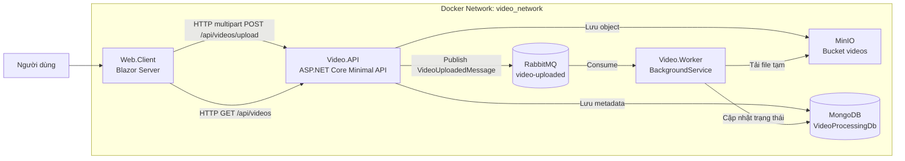

# BÁO CÁO BÀI TẬP LỚN

# Hệ thống xử lý video phân tán bất đồng bộ bằng .NET 10

## 1. Mô tả bài toán

Dự án xây dựng một hệ thống xử lý video theo kiến trúc phân tán, tách luồng upload, lưu trữ file, quản lý trạng thái và xử lý nền. Người dùng chọn video qua giao diện Blazor Server. API nhận file, lưu nội dung vào MinIO, lưu metadata vào MongoDB và phát một message sang RabbitMQ. Worker tiếp tục lấy message để tải file tạm về máy, mô phỏng xử lý nặng bằng `Task.Delay(5000)`, cập nhật trạng thái và xác nhận/xóa message khỏi hàng đợi.

Các trạng thái video gồm:

- `Pending`: file đã upload nhưng Worker chưa bắt đầu xử lý.
- `Processing`: Worker đang xử lý file.
- `Completed`: xử lý giả lập hoàn thành.
- `Failed`: xảy ra lỗi trong quá trình xử lý.

## 2. Phân tích yêu cầu

### 2.1 Yêu cầu chức năng

- Người dùng chọn và upload một file video từ Web.Client.
- API sinh GUID làm `VideoId`, tải file vào bucket `videos` của MinIO và lưu metadata vào MongoDB.
- API phát `VideoUploadedMessage` chứa `VideoId` và `FileName` qua RabbitMQ.
- Worker consume queue, cập nhật trạng thái, tải file xuống thư mục tạm và mô phỏng xử lý trong 5 giây.
- Worker xác nhận message bằng Ack sau khi hoàn thành; khi lỗi cập nhật `Failed` và dùng Nack.
- Giao diện hiển thị danh sách video và tự làm mới mỗi 3 giây.

### 2.2 Yêu cầu phi chức năng

- Các thành phần chạy độc lập trong container Docker.
- Giao tiếp nội bộ qua DNS của Docker network.
- Sử dụng named volume để duy trì dữ liệu MongoDB, MinIO và RabbitMQ.
- Cấu hình có thể ghi đè bằng environment variables.
- API và Worker có build/runtime image riêng.

## 3. Sơ đồ kiến trúc hệ thống



## 4. Thiết kế các thành phần

### 4.1 Video.Contracts

Project chứa record dùng chung để serial hóa message RabbitMQ:

```csharp
public sealed record VideoUploadedMessage(string VideoId, string FileName);
```

Việc đặt contract ở project riêng tránh trùng định nghĩa và giúp API cùng Worker dùng một cấu trúc message nhất quán.

### 4.2 Video.API

Video.API là ASP.NET Core Minimal API trên .NET 10.

#### Endpoint upload

`POST /api/videos/upload` thực hiện:

1. Nhận `IFormFile file`.
2. Sinh GUID với định dạng chuỗi.
3. Tạo object name `GUID + phần mở rộng file`.
4. Upload stream tới MinIO.
5. Lưu `VideoMetadata` trạng thái `Pending` vào MongoDB.
6. Publish `VideoUploadedMessage` qua RabbitMQ.
7. Trả `202 Accepted` cùng `videoId`.

#### Endpoint danh sách

`GET /api/videos` truy vấn toàn bộ collection và sắp xếp `UploadedAt` giảm dần trước khi trả kết quả JSON.

### 4.3 Video.Worker

Worker kế thừa `BackgroundService` và dùng RabbitMQ async consumer. Khi nhận message:

1. Giải mã JSON thành `VideoUploadedMessage`.
2. Cập nhật MongoDB trạng thái `Processing`.
3. Tải object tương ứng từ MinIO vào file tạm trên worker.
4. Chờ `Task.Delay(5000)` để mô phỏng xử lý nặng.
5. Cập nhật MongoDB trạng thái `Completed`.
6. Xóa file tạm trong `finally`.
7. Gửi BasicAck để loại message khỏi queue.

Nếu xử lý hoặc tải file lỗi, Worker cập nhật `Failed` rồi dùng BasicNack. Nếu không cập nhật được trạng thái MongoDB, message được requeue để thử lại.

### 4.4 Web.Client

Web.Client là Blazor Server trên .NET 10.

- Đăng ký named `HttpClient` trỏ tới API.
- Dùng `InputFile` để chọn file.
- Gửi file dạng `multipart/form-data` tới API.
- Hiển thị bảng `Id`, `FileName`, `UploadedAt` và `Status`.
- Dùng `PeriodicTimer` 3 giây để gọi `GET /api/videos` định kỳ.
- Hủy timer bằng `CancellationTokenSource` khi component bị dispose.

### 4.5 MongoDB

Bản ghi metadata được ánh xạ bởi `BsonId`:

- `Id`: GUID dạng string.
- `FileName`: tên file gốc.
- `Status`: `Pending`, `Processing`, `Completed` hoặc `Failed`.
- `UploadedAt`: thời điểm upload.

## 5. Cơ chế giao tiếp phân tán

### 5.1 REST/HTTP

Blazor giao tiếp với API bằng HTTP. Upload dùng multipart POST; danh sách trạng thái dùng GET JSON. Đây là giao diện đồng bộ phù hợp với tương tác người dùng.

### 5.2 RabbitMQ

API phát message trên queue `video-uploaded`. Worker đăng ký queue với prefetch count là 1, nên mỗi Worker chỉ nhận một message chưa ack tại một thời điểm. Ack xác nhận xử lý thành công; Nack xử lý trường hợp thất bại.

### 5.3 MinIO

File được lưu theo object name `VideoId + phần mở rộng`. API upload bằng stream; Worker tải object bằng callback stream và ghi ra file tạm.

### 5.4 MongoDB

MongoDB lưu trạng thái metadata độc lập với nội dung file. API và Worker dùng cùng collection để các trạng thái thay đổi có thể được đọc realtime qua endpoint danh sách.

## 6. Triển khai Docker

Mỗi project `.NET` có Dockerfile multi-stage riêng:

- SDK image thực hiện restore và publish.
- Runtime hoặc ASP.NET runtime image chứa artifact cuối.
- Build context là thư mục solution để Dockerfile truy cập `Video.Contracts`.

Docker Compose khởi động sáu service:

- `mongodb`
- `minio`
- `rabbitmq`
- `video-api`
- `video-worker`
- `web-client`

Tất cả service ở chung network `video_network`. Environment variables ghi đè chuỗi `localhost` trong `appsettings.json` bằng service name nội bộ.

### Bảng port

| Service | Cổng host | Cổng container |
|---|---:|---:|
| Web.Client | 8080 | 8080 |
| Video.API | 8081 | 8080 |
| MongoDB | 27017 | 27017 |
| MinIO API | 9000 | 9000 |
| MinIO Console | 9001 | 9001 |
| RabbitMQ AMQP | 5672 | 5672 |
| RabbitMQ Management | 15672 | 15672 |

### Các lệnh triển khai

```powershell
docker compose config
docker compose build
docker compose up -d
docker compose ps
docker compose logs -f
```

Mở giao diện: `http://localhost:8080`.

## 7. Hướng dẫn kiểm thử luồng nghiệp vụ

1. Mở `http://localhost:8080`.
2. Chọn một file video bằng `InputFile`.
3. Nhấn Upload.
4. API trả `202 Accepted` và metadata xuất hiện với trạng thái `Pending`.
5. Worker đặt trạng thái `Processing`.
6. Sau khoảng 5 giây Worker đặt trạng thái `Completed`.
7. Quan sát bảng tự làm mới sau mỗi 3 giây.
8. Kiểm tra object trong MinIO Console và message queue trong RabbitMQ Management nếu cần.

## 8. Đánh giá hệ thống

### Ưu điểm

- Tách API và xử lý nền theo nguyên tắc producer/consumer.
- Khả năng scale Worker theo số lượng queue consumer.
- Nội dung file và metadata được lưu riêng, phù hợp lưu trữ object.
- Docker Compose giúp toàn bộ hạ tầng khởi động nhất quán.
- UI cập nhật trạng thái định kỳ mà không cần reload trang.

### Hạn chế

- Tương tác Worker hiện chỉ mô phỏng bằng `Task.Delay(5000)`, chưa tích hợp FFmpeg thật.
- Chưa có cơ chế retry/backoff và dead-letter queue đầy đủ.
- Chưa có xác thực hoặc phân quyền cho API và giao diện.
- Chưa giới hạn kích thước loại file ở mức nghiệp vụ ngoài giới hạn upload của Blazor.
- Cơ chế xử lý Worker trong báo cáo là mẫu đơn giản, chưa có theo dõi worker health hoặc distributed tracing.

### Hướng phát triển

- Tích hợp FFmpeg để transcode, nén hoặc tạo thumbnail.
- Thêm dead-letter queue và retry policy có thời gian chờ tăng dần.
- Thêm SignalR để đẩy trạng thái realtime thay vì polling.
- Thêm OpenAPI, kiểm tra dữ liệu và authentication/authorization.
- Thêm health endpoint và telemetry với Prometheus/OpenTelemetry.
- Tách cấu hình credentials khỏi Compose bằng Docker secrets hoặc secret manager.
