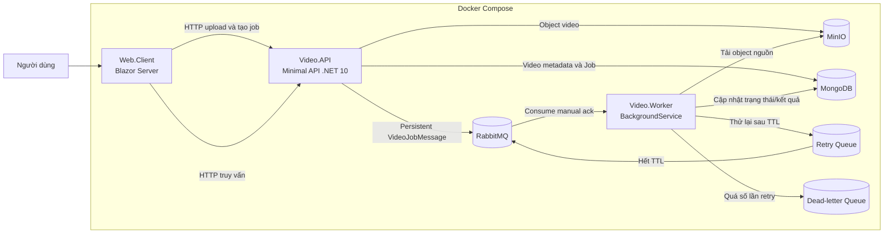

# BÁO CÁO BÀI TẬP LỚN

# Đề tài 14: Hệ thống xử lý video bất đồng bộ

## 1. Bài toán

Upload video có thể kéo theo các tác vụ tốn CPU, bộ nhớ và thời gian như phân tích metadata, chuyển mã hoặc tạo thumbnail. Nếu xử lý ngay trong request HTTP, người dùng phải chờ lâu; request có thể timeout và API khó mở rộng độc lập với tải xử lý.

Đề tài xây dựng hệ thống phân tán tách tiếp nhận video khỏi xử lý nền. API lưu file và metadata, phát sinh job vào message broker, Worker xử lý độc lập và ghi trạng thái để client truy vấn. Thiết kế hướng tới khả năng tiếp tục xử lý sau khi Worker khởi động lại, tránh xử lý lặp không cần thiết và cô lập message lỗi.

Bản hiện tại lưu video và artifact trên MinIO, quản lý video/job trên hai collection MongoDB. Worker tạo thumbnail JPEG bằng FFmpeg, trích xuất metadata file thành JSON và tạo artifact JSON mô phỏng cho tác vụ transcode (chưa chuyển mã codec thật).

## 2. Phân tích yêu cầu

### 2.1 Yêu cầu chức năng

- Nhận multipart upload video, lưu object vào MinIO và metadata vào MongoDB.
- Tạo job riêng cho video, lưu job trước khi gửi message đến RabbitMQ.
- Worker nhận job, cập nhật trạng thái và ghi kết quả/lỗi.
- Tra cứu danh sách video có lọc trạng thái, chi tiết video cùng các job liên quan, trạng thái/tiến độ từng job và tải artifact kết quả.
- Endpoint nghiệp vụ gọi được ở cả dạng `/videos` và `/api/videos`.
- Truyền Correlation ID từ HTTP qua message sang log Worker.

### 2.2 Yêu cầu phi chức năng

- Chạy các thành phần qua Docker Compose và Docker network riêng.
- Lấy connection string, host dịch vụ và credentials từ biến môi trường; không đưa secrets vào source hoặc appsettings.
- Dùng durable queue và persistent message.
- Worker dùng manual acknowledgement; chỉ ack sau xử lý thành công, retry hoặc chuyển DLQ thành công.
- Chống xử lý lặp job đã hoàn thành, có retry giới hạn và DLQ.
- Có health endpoint cho API và Worker để Docker giám sát.

## 3. Kiến trúc hệ thống



Client giao tiếp đồng bộ với API qua HTTP. RabbitMQ tách API khỏi xử lý video. MongoDB lưu trạng thái nghiệp vụ; MinIO giữ nội dung video. Queue retry có thời gian chờ trước khi message quay lại queue chính. Message vượt số lần thử được Worker publish vào dead-letter queue riêng.

## 4. Thiết kế các thành phần

### 4.1 Web.Client

Blazor Server cung cấp giao diện upload, chọn loại job, lọc video theo trạng thái, theo dõi tiến độ và xem/tải artifact. Luồng upload thực hiện hai request: gửi file tới `POST /videos`, sau đó tạo job bằng `POST /videos/{id}/jobs`. Client tạo một Correlation ID và gửi cùng giá trị qua header `X-Correlation-ID` của cả hai request.

### 4.2 Video.API

Minimal API có năm endpoint nghiệp vụ; mỗi route được ánh xạ hai lần để hỗ trợ cả tiền tố rỗng và `/api`:

| Phương thức | Route | Chức năng |
| --- | --- | --- |
| `POST` | `/videos` | Multipart field `file`; lưu file MinIO và metadata MongoDB. |
| `POST` | `/videos/{id}/jobs` | Tạo job `Thumbnail`, `Metadata` hoặc `Transcode`, publish `VideoJobMessage`, trả `202 Accepted`. |
| `GET` | `/videos` | Liệt kê video mới nhất trước; hỗ trợ `?status=Completed`. |
| `GET` | `/videos/{id}` | Trả video và các job liên quan. |
| `GET` | `/jobs/{id}` | Trả trạng thái, kết quả, lỗi và Correlation ID của job. |

`GET /jobs/{id}/result` trả artifact lưu trên MinIO. Job có `Id`, `VideoId`, `JobType`, `Status`, `Progress`, `OutputPath`, `Result`, `CreatedAt` và `UpdatedAt`.

Các route trên đều có alias bắt đầu bằng `/api`, ví dụ `/api/videos/{id}`. `GET /health` kiểm tra MongoDB và trả HTTP 503 nếu không kết nối được.

Khi upload, API tạo GUID làm video ID và object name, lưu file trước rồi ghi metadata. Tạo job là thao tác độc lập; API tạo Job trạng thái `Pending`, lưu vào MongoDB rồi publish message. Nếu publish phát sinh lỗi, API đánh dấu job `Failed` thay vì để bản ghi Pending vô thời hạn.

### 4.3 Video.Worker

Worker sử dụng `AsyncEventingBasicConsumer`, queue chính durable và `autoAck: false`. Prefetch bằng 1 để giới hạn một message chưa xác nhận trên mỗi consumer. Khi nhận message:

1. Đọc `JobId`, `VideoId`, loại job và Correlation ID.
2. Truy vấn MongoDB; nếu job đã `Completed`, bỏ qua xử lý và ack message.
3. Worker atomically chuyển job `Pending` sang `Processing` để chỉ một consumer nhận quyền xử lý; duplicate được bỏ qua. Tải file từ MinIO và cập nhật tiến độ 25%, 60%, 100%.
4. Tạo thumbnail JPEG bằng FFmpeg, metadata JSON hoặc artifact JSON mô phỏng transcode; tải artifact lên MinIO, lưu `OutputPath`/`Result`, cập nhật trạng thái video rồi mới `BasicAck`.
5. Khi lỗi, publish message persistent sang retry queue hoặc DLQ rồi ack bản gốc. Nếu publish thất bại, nack với `requeue=true` để không loại bỏ message.

Worker chỉ đánh dấu `Failed` khi hết lượt retry và message được chuyển vào DLQ. Mặc định có 3 lượt retry sau lần thử ban đầu, delay 5 giây qua queue TTL. Worker health endpoint tại cổng nội bộ 8082 kiểm tra MongoDB và trạng thái RabbitMQ connection.

### 4.4 RabbitMQ và độ bền message

Queue `video-uploaded` được khai báo `durable=true`; publisher đặt `DeliveryMode=Persistent`. Queue retry `video-uploaded.retry` durable, có `x-message-ttl`, và dead-letter routing message trở lại queue chính sau khi hết TTL. Queue `video-uploaded.dead` durable, giữ message lỗi vượt giới hạn.

Worker dùng manual ack. Ack được gửi sau khi ghi kết quả thành công, sau khi xác nhận job đã Completed, hoặc sau khi publish bản sao persistent vào retry/DLQ. Nack/requeue được dùng khi không thể chuyển message lỗi sang queue tiếp theo. Kết nối RabbitMQ thử lại khi khởi động với backoff giới hạn.

### 4.5 MongoDB và MinIO

MongoDB lưu hai nhóm dữ liệu:

- Collection `Videos`: ID, tên file, trạng thái và thời điểm upload.
- Collection `Jobs`: ID, video liên quan, loại job, trạng thái, tiến độ, output path, thời điểm tạo/cập nhật, kết quả/lỗi và Correlation ID.

MinIO lưu file nguồn trong bucket `videos`, object key được tạo từ video ID và phần mở rộng tên file; artifact lưu dưới `processed/{videoId}/{jobId}`. File tạm trong Worker được xóa trong `finally`.

### 4.6 Correlation ID và logging

Middleware API nhận `X-Correlation-ID`; nếu thiếu hoặc không hợp lệ, API tạo ID mới và trả lại trong response header. ID đi vào message body và header RabbitMQ `CorrelationId`. Worker dùng structured logging scopes với Correlation ID, JobId và VideoId để lọc log theo cùng một luồng nghiệp vụ.

## 5. Cơ chế giao tiếp phân tán

### 5.1 HTTP

Web.Client gọi API bằng HTTP. Upload dùng `multipart/form-data`; các thao tác tạo job và đọc trạng thái dùng JSON/HTTP. API trả `202 Accepted` khi job đã được ghi và đưa vào RabbitMQ.

### 5.2 Message queue

API là producer, Worker là consumer. `VideoJobMessage` mang JobId, VideoId, tên file, loại job và Correlation ID. Queue durable cùng message persistent giúp message tồn tại qua việc RabbitMQ restart theo cấu hình broker. Retry queue đưa message về queue chính sau delay; sau khi đạt giới hạn, Worker đưa message vào DLQ để kiểm tra.

### 5.3 Lưu trữ

MongoDB là nguồn dữ liệu trạng thái có thể truy vấn; MinIO lưu payload video dung lượng lớn. Tách hai loại dữ liệu cho phép scale và sao lưu độc lập.

## 6. Cách triển khai

### 6.1 Cấu hình môi trường

Sao chép `.env.example` thành `.env` tại thư mục gốc và thay credential local trước khi dùng. `.env` được ignore bởi Git. Compose yêu cầu `MONGODB_CONNECTION_STRING`, `MINIO_ROOT_USER`, `MINIO_ROOT_PASSWORD`, `RABBITMQ_DEFAULT_USER`, `RABBITMQ_DEFAULT_PASS` và `RABBITMQ_URI`. Các host bên trong container dùng tên service trên Docker network.

### 6.2 Khởi động bằng Docker Compose

```powershell
Copy-Item .env.example .env
docker compose config --quiet
docker compose build
docker compose up -d
docker compose ps
```

Compose chạy MongoDB, MinIO, RabbitMQ, Video.API, Video.Worker và Web.Client; named volume giữ dữ liệu sau khi container dừng.

Compose hiện pin image `bitnamilegacy/minio` đã ngừng cập nhật; cấu hình này chỉ dành cho bài tập/local development và cần thay bằng image được duy trì trước triển khai lâu dài.

| Thành phần | Cổng host |
| --- | ---: |
| Web.Client | `.env`: `WEB_CLIENT_HOST_PORT` |
| Video.API | `.env`: `VIDEO_API_HOST_PORT` |
| MongoDB | `.env`: `MONGODB_HOST_PORT` |
| MinIO API / Console | `.env`: `MINIO_API_HOST_PORT` / `MINIO_CONSOLE_HOST_PORT` |
| RabbitMQ AMQP / Management | `.env`: `RABBITMQ_AMQP_HOST_PORT` / `RABBITMQ_MANAGEMENT_HOST_PORT` |

Compose healthcheck các dịch vụ MongoDB, MinIO, RabbitMQ, API và Worker; API/Worker đợi các dependency khỏe mạnh, Web.Client đợi API khỏe mạnh.

### 6.3 Kiểm thử thủ công

1. Mở `http://localhost:8080` hoặc upload trực tiếp qua `POST /videos`.
2. Lấy `videoId` từ response và gọi `POST /videos/{videoId}/jobs`.
3. Dùng `GET /jobs/{jobId}` theo dõi trạng thái.
4. Dùng `GET /videos/{videoId}` kiểm tra video cùng danh sách jobs.
5. Xem log bằng `docker compose logs -f video-api video-worker` và queue bằng RabbitMQ Management.

Build source ngoài Docker:

```powershell
dotnet build src/Video.API/Video.API.csproj
dotnet build src/Video.Worker/Video.Worker.csproj
dotnet build src/Web.Client/Web.Client.csproj
```

Khi chạy ngoài Docker, phải cấp connection string, endpoint và credentials bằng environment variables; không có cấu hình localhost/secret mặc định trong appsettings.

## 7. Kết quả thực hiện

- Hoàn thiện năm endpoint nghiệp vụ và alias `/api`; bổ sung tải artifact tại `/jobs/{id}/result`.
- Upload file vào MinIO và video metadata vào MongoDB; tách Job thành bản ghi riêng.
- Worker xử lý message persistent bằng manual ack/nack.
- Idempotency dùng atomic claim trên job `Pending`, bỏ qua duplicate không đủ điều kiện claim.
- Retry queue có TTL và DLQ riêng, với retry tối đa cấu hình được.
- API và Worker có health endpoint; Docker Compose thăm dò trạng thái container.
- Correlation ID đi từ header HTTP qua RabbitMQ tới structured log của Worker.
- Blazor hỗ trợ chọn loại job, lọc trạng thái, xem tiến độ/kết quả và tải artifact.
- API, Worker và Web.Client đã được kiểm tra build trong môi trường phát triển. Cảnh báo dependency transitives SharpCompress/Snappier được ghi nhận; cần lập kế hoạch cập nhật dependency riêng.

## 8. Đánh giá hệ thống

### Khả năng chịu lỗi

- Nếu Worker dừng trước ack, RabbitMQ có thể redeliver message chưa được xác nhận khi consumer/channel mất kết nối.
- Nếu job đã Completed nhưng message bị redeliver, kiểm tra trạng thái MongoDB giúp bỏ qua lần xử lý trùng.
- Queue durable và message persistent giảm nguy cơ mất message khi broker restart; độ bền thực tế còn phụ thuộc cấu hình persistence/replication của RabbitMQ và storage.
- Lỗi xử lý được retry có delay; lỗi kéo dài được cô lập trong DLQ thay vì lặp vô hạn.
- Healthcheck cho phép Docker nhận biết API/Worker không thể truy cập MongoDB hoặc Worker mất kết nối RabbitMQ.

### Tính năng mở rộng đã triển khai

- Idempotent consumer dựa trên trạng thái Job trong MongoDB.
- Dead-letter queue riêng và retry queue có TTL.
- Correlation ID cho truy vết request/message/log.
- API hỗ trợ route có và không có `/api`.
- Cấu hình secrets/host qua environment thay vì hardcode trong appsettings.

### Hạn chế và hướng phát triển

- Tác vụ transcode hiện chỉ tạo JSON mô phỏng; cần tích hợp FFmpeg profile/codec thật nếu yêu cầu chuyển mã video.
- Chưa có transactional outbox: lỗi tiến trình giữa lúc ghi Job MongoDB và publish RabbitMQ có thể để lại job Pending không có message. Nên dùng outbox hoặc cơ chế reconciliation khi đưa vào production.
- Publish/retry hiện dùng persistent messages nhưng chưa bật publisher confirms; cần bổ sung confirms và xử lý kết quả xác nhận để tăng đảm bảo giao nhận.
- Hệ thống chưa có xác thực/phân quyền, giới hạn loại file/kích thước ở tầng nghiệp vụ đầy đủ, TLS, secret manager hoặc giám sát metrics/tracing.
- API health hiện xác minh MongoDB; Worker health xác minh MongoDB, RabbitMQ và MinIO.
- Cần bổ sung integration tests cho upload, job lifecycle, retry/DLQ và phục hồi khi Worker restart.